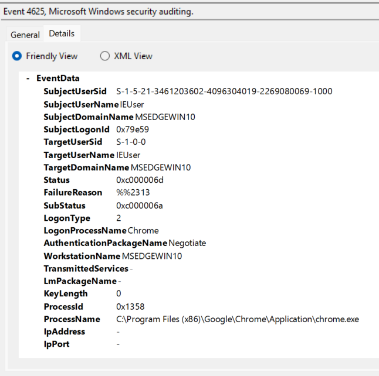

# 01: Failed Logon (4625) in an EVTX sample

**Dataset:** EVTX-ATTACK-SAMPLES (sbousseaden)
**File:** `CA_4624_4625_LogonType2_LogonProc_chrome.evtx`
**Tool:** Windows Event Viewer
**MITRE ATT&CK category:** Credential Access

## Evidence

## What fired?

Event ID: 4625 Mean: an attempt to log on to the machine was rejected(0xC000006D)

## Who, how and where?

- **Targeted account:** IEUser
- **Logon Type:** 2 (Interactive, at the local keyboard)
- **Failure reason (Sub Status):** 0xC000006A (username exists, password was wrong)
- **Source IP / workstation:** the logon was local, so there is no network source. Workstation is MSEDGEWIN10
- **Subject (the account whose session made the request):** IEUser
- **Process involved:** C:\Program Files (x86)\Google\Chrome\Application\chrome.exe, LogonProcessName: Chrome

## What I can prove vs. what I'm guessing

- **Proven by the log:** a logon attempt carrying chrome.exe as the process failed, because the password foe IEUser was wrong.
- **My interpretation (not proven):** that chrome was asking to verify password for a particular reason. The log record shows which process made the attempt. not its intentions
## 4624 events and the full story

(To be added after we read the three 4624 events.)
