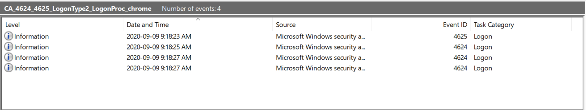
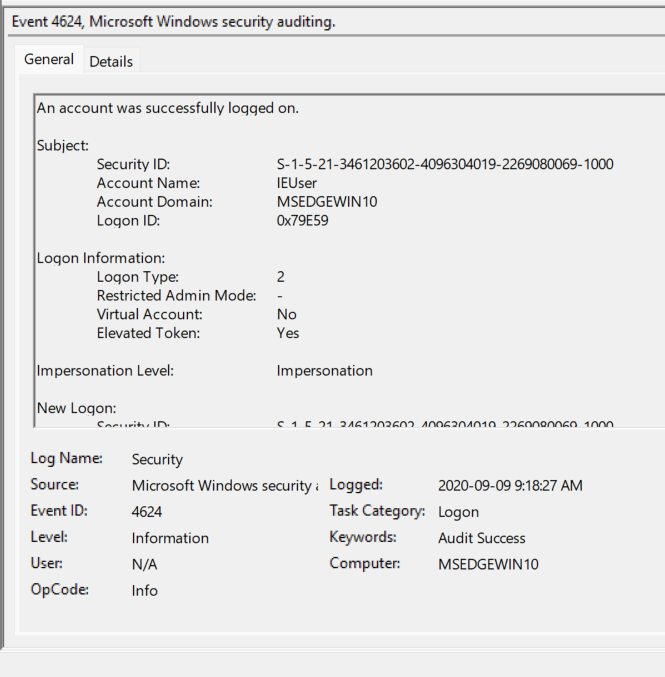

# 01: Failed Logon (4625) followed by Successful Logons (4624)

**Dataset:** EVTX-ATTACK-SAMPLES (sbousseaden)
**File:** `CA_4624_4625_LogonType2_LogonProc_chrome.evtx`
**Tool:** Windows Event Viewer
**MITRE ATT&CK category:** Credential Access (folder the sample is filed under)

## Summary

The file contains four events: one failed logon (4625) and three successful logons (4624). A local logon attempt by `chrome.exe` failed because of a wrong password, and about 4 seconds later the same process succeeded. The log alone cannot show why, so my verdict is low confidence, leaning benign.

## Evidence

Event list in time order:

The failed logon (4625):

The elevated successful logon (4624):

## Timeline (UTC, 2020-09-09)

| Time | Event | What happened |
|---|---|---|
| 13:18:23.63 | 4625 | `chrome.exe` logon attempt for IEUser failed (wrong password) |
| 13:18:27.71 | 4624 (Type 2) | Same process, same user, logon succeeded (elevated session) |
| 13:18:27.71 | 4624 (Type 2) | Second session created 0.15 ms later (restricted session) |
| 13:18:25.37 | 4624 (Type 5) | SYSTEM service logon by `services.exe` |

The failure and the success are about 4 seconds apart. That is a human-sized gap, not the rapid-fire pattern of automated guessing.

## What fired?

**Event ID 4625**: an attempt to log on to the machine was rejected. Status `0xC000006D` is the general "logon failed" code.

## Who, how and where?

- **Targeted account:** `IEUser` (domain `MSEDGEWIN10`), from the Target fields
- **Logon Type:** 2 (Interactive, at the local keyboard)
- **Failure reason (Sub Status):** `0xC000006A`, meaning the username exists but the password was wrong
- **Source IP:** `-` (none). The logon was local, so there was no network source
- **Workstation:** `MSEDGEWIN10`
- **Subject (the account whose session made the request):** `IEUser`, domain `MSEDGEWIN10`, SubjectLogonId `0x79e59`. This was an already logged-in user session, not the machine account
- **Process involved:** `C:\Program Files (x86)\Google\Chrome\Application\chrome.exe` (LogonProcessName `Chrome`, ProcessId `0x1358`)

## The three 4624 events

| Event | Account | Type | Process | Notes |
|---|---|---|---|---|
| A | SYSTEM | 5 (Service) | `services.exe` | Routine Windows background activity. Set aside in triage |
| B | IEUser | 2 | `chrome.exe` | TargetLogonId `0x1cd8f6`, linked ID `0x1cd964`, elevated token |
| C | IEUser | 2 | `chrome.exe` | TargetLogonId `0x1cd964`, linked ID `0x1cd8f6`, no elevated token |

**B and C are one logon, not two.** Each one's `TargetLinkedLogonId` equals the other's `TargetLogonId`. This is what Windows does when an administrator logs on with UAC enabled: it creates one restricted and one elevated session and links them. Recognizing this pair avoids treating a normal logon as two suspicious ones.

## What I can prove vs. what I'm interpreting

**Proven by the log:**
- A logon attempt made by `chrome.exe` inside IEUser's session failed because the password was wrong.
- About 4 seconds later the same process, user and Logon Type succeeded.
- The attempt was local, with no source IP.
- Only one failure occurred, so there was no burst.
- The two Chrome 4624s are a linked UAC session pair.

**My interpretation (not proven):**
- *Harmless:* the user mistyped their Windows password when Chrome asked for it, then retried.
- *Worrying:* a process inside or posing as Chrome tested credentials. The sample is filed under Credential Access, so it may have been made to demonstrate an attack.
- Source to check: the sample's description in the EVTX-ATTACK-SAMPLES README.

## Triage verdict

Low confidence, leaning benign. A single failure, a 4 second human sized gap, a local logon and a normal UAC session pair do not justify escalation on their own. A real analyst would look for follow-up activity, such as unexpected 4688 process events or the account being used elsewhere. A dataset of 4 events cannot show counts or patterns, so conclusions here are limited.

## What I learned

1. Read the time gap precisely. Here it is seconds, not minutes.
2. Subject is the account whose session made the request. It is not always the machine, so read the fields.
3. Two 4624s with swapped Logon IDs are one UAC logon, not two.
4. A log shows what happened, not why. Keep proven facts apart from guesses.
